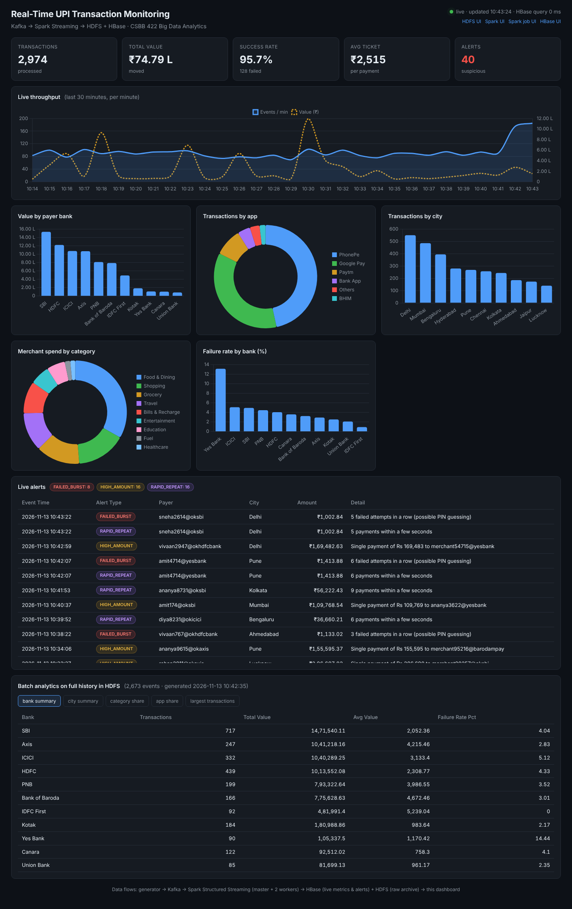
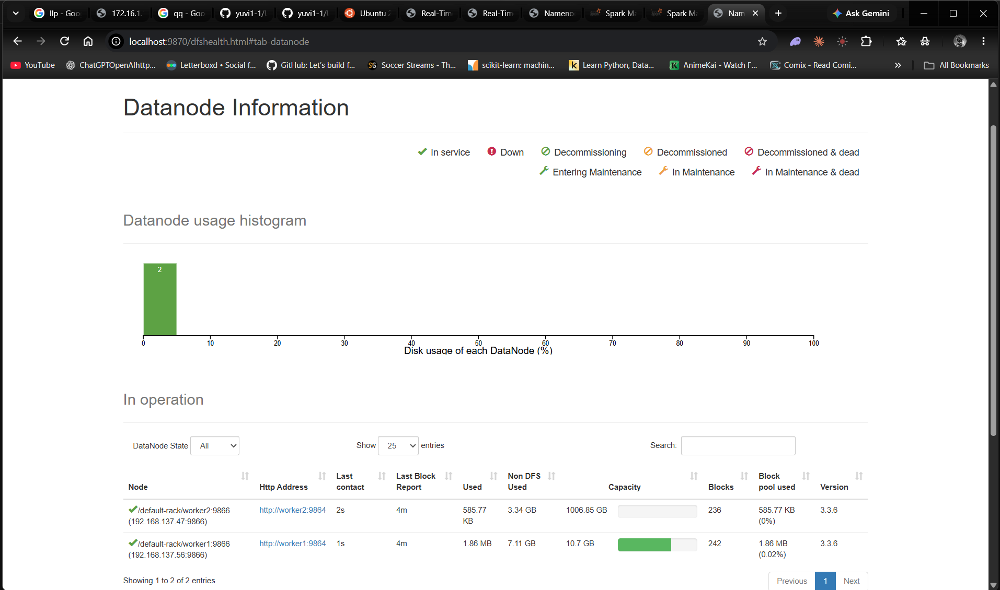
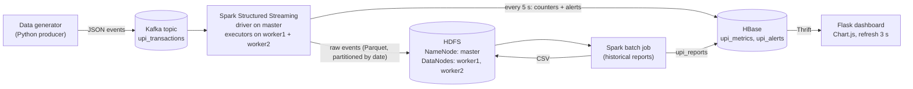

# Real-Time UPI Transaction Monitoring and Anomaly Detection
### Kafka · Spark Structured Streaming · HDFS · HBase

**CSBB 422 – Big Data Analytics, Lab Project · NIT Delhi**
Group: Yuvraj Pegu - (231210129), Viraj Tyagi - (231210124), Srishu Ray - (231210098), Vivek Bhardwaj - (231210125) 

A real-time pipeline that ingests a live stream of UPI payments, computes live metrics (volume and value by bank, city, app and merchant category, success/failure rates) and flags suspicious activity — very large payments, rapid repeated payments and bursts of failed attempts — on a distributed Hadoop/Spark cluster (1 master + 2 workers).



### Running on our 3-laptop cluster
Master = Legion laptop (WSL), worker1 = MacBook (Ubuntu VM), worker2 = second Windows laptop (WSL). All on the same Wi‑Fi.


| Spark master: 2 alive workers, streaming job using both | HDFS NameNode: 2 live DataNodes (worker1, worker2) |
|---|---|
|  |  |

Spark job UI (`:4040`): one micro-batch job every 5 seconds.


---

## Architecture



| Node | Services |
|---|---|
| **Master PC** | HDFS NameNode · Spark Master + driver · Kafka broker (KRaft) · HBase + Thrift · generator · dashboard |
| **Worker PC 1** | HDFS DataNode · Spark Worker |
| **Worker PC 2** | HDFS DataNode · Spark Worker |

### Why each component
- **Kafka** decouples the producer from processing and buffers bursts; events are keyed (payer / area) across 3 partitions.
- **Spark Structured Streaming** processes micro-batches every 5 s in parallel on the two workers, runs group-by aggregations and the anomaly rules, and checkpoints to HDFS so it recovers after a crash without double counting the Kafka offsets.
- **HDFS** permanently stores every raw event as Parquet (replication factor 2 — one copy per worker) for the batch job.
- **HBase** serves the live results: atomic counters (`counter_inc`) make each micro-batch an increment, and reverse-timestamp row keys make "latest alerts" a cheap prefix scan.
- **Spark batch job** reads the full history from HDFS and writes reports to HDFS (CSV) and HBase.

---

## Repository layout

```
common/            shared code
  config.py        all hosts/ports (env-overridable)
  engine.py        Kafka -> Spark Streaming -> HDFS + HBase pipeline (foreachBatch)
  batch.py         HDFS -> Spark batch -> reports
  store.py         HBase access (happybase/Thrift) + in-memory store for tests
upi/               generator.py (simulated UPI stream) · logic.py (schema, aggregates, alert rules, reports)
                   stream_job.py (Spark Streaming entry point) · batch_report.py (Spark batch entry point)
dashboard/         Flask app + Chart.js front end
scripts/           Docker helpers (start/run_stream/run_batch/stop) and native/ scripts for the 3-PC cluster
docker/            Dockerfiles + Hadoop config for the single-laptop version
docs/              SETUP_3_PCS.md (real cluster guide), VIVA_NOTES.md, screenshots
tests/             local test of the Spark logic + dashboard preview (no cluster needed)
```

---

## Running it

### A. Real cluster (3 PCs) — used for the demo
Full step-by-step guide: **[docs/SETUP_3_PCS.md](docs/SETUP_3_PCS.md)**. Once installed:
```bash
./scripts/native/start_cluster.sh          # HDFS, Spark, Kafka, HBase on all nodes
./scripts/native/run_stream.sh         # terminal 1
./scripts/native/run_generator.sh 20   # terminal 2
./scripts/native/run_dashboard.sh      # terminal 3 -> http://master:5000
./scripts/native/run_batch.sh          # any time later: historical report
```

### B. Single laptop with Docker (same roles, in containers)
Needs Docker Desktop with ~6 GB RAM.
```bash
./scripts/start.sh          # starts 10 containers, creates HDFS dirs + HBase tables
./scripts/run_stream.sh     # keep this terminal open
# dashboard: http://localhost:5000 · HDFS: :9870 · Spark: :8080 · HBase: :16010
./scripts/run_batch.sh      # after a few minutes
./scripts/stop.sh
```

### C. No cluster at all (check the code)
```bash
pip install pyspark==3.5.1 flask
python tests/test_local.py              # runs the pipeline through the real Spark code
python tests/preview_dashboard.py   # live dashboard at http://localhost:5000
```

---

## Data model

### Kafka events
`txn_id, event_time, payer_vpa, payee_vpa, payer_bank, payee_bank, city, app, txn_type (P2P/P2M), category, amount, status`

### HBase tables
| Table | Row key | Columns |
|---|---|---|
| `upi_metrics` | `<dimension>\|<value>` e.g. `bank\|SBI`, `minute\|202611141530`, `total\|all` | `m:count`, `m:amount` (paise), and project counters (`m:failed`, `m:delayed`, …) — all HBase atomic counters |
| `upi_alerts` | `<10^13 − epoch_ms>\|<id>` (newest first) | `a:alert_type`, `a:event_time`, `a:amount`, `a:detail`, … |
| `upi_reports` | report name | `r:json` |

HDFS: `/bigdata/upi/raw/event_date=YYYY-MM-DD/*.parquet`, `/bigdata/upi/reports/<name>/`, `/bigdata/upi/checkpoints/`

### Alert rules
| Alert | Rule |
|---|---|
| `HIGH_AMOUNT` | single payment ≥ ₹1,00,000 |
| `RAPID_REPEAT` | ≥ 5 payments from one VPA in one 5-second micro-batch |
| `FAILED_BURST` | ≥ 3 failed attempts from one VPA in one micro-batch |

The generator injects these patterns on purpose (~1 % of traffic) so the rules can be shown live.

---

## Tech stack
Hadoop 3.3.6 (HDFS) · Spark 3.5.1 (Structured Streaming, SQL) · Kafka 3.7.0 (KRaft) · HBase 2.5 · Python 3 (PySpark, kafka-python-ng, happybase, Flask) · Chart.js
