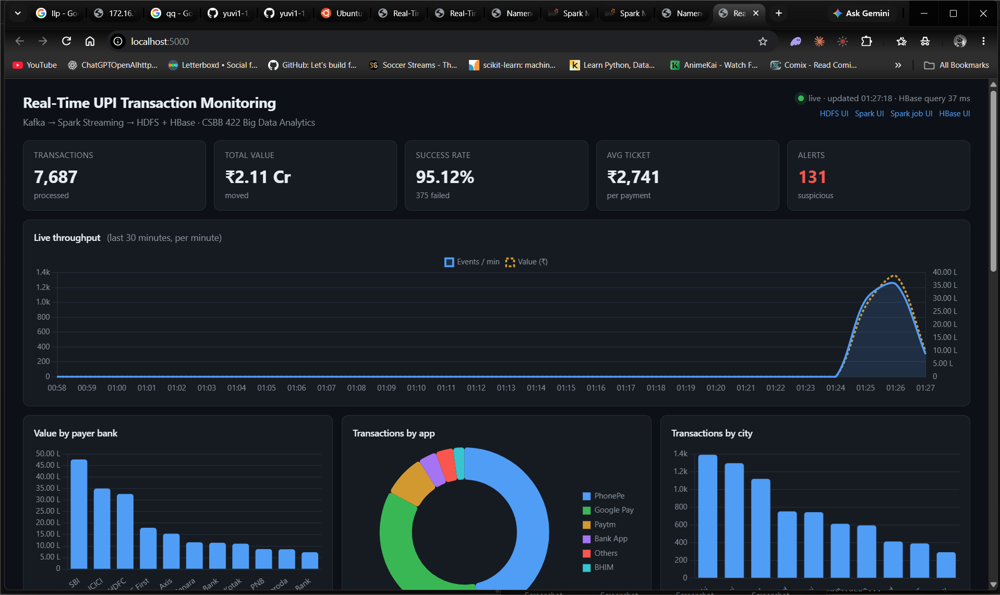
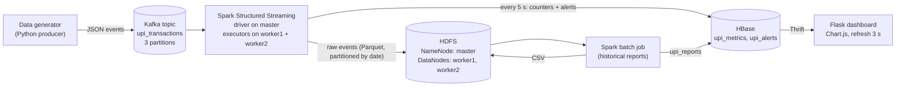
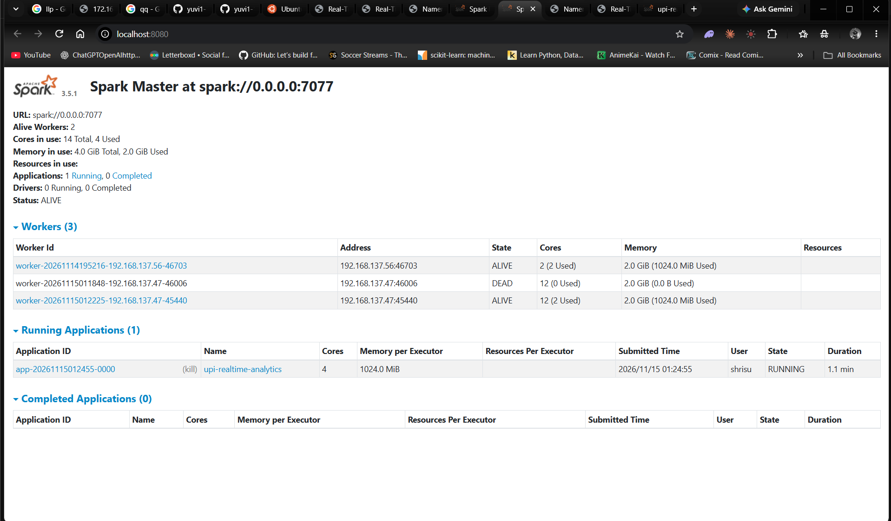
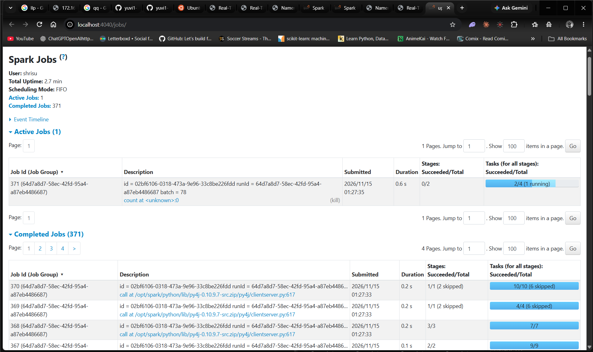

# Real-Time UPI Transaction Monitoring and Anomaly Detection
### Project Report · CSBB 422 – Big Data Analytics Lab · NIT Delhi

| Name | Roll No. |
|---|---|
| Yuvraj Pegu | 231210129 |
| Viraj Tyagi | 231210124 |
| Srishu Ray | 231210098 |
| Vivek Bhardwaj | 231210125 |

**Tech stack:** Apache Kafka 3.7 · Apache Spark 3.5.1 (Structured Streaming + SQL) · Hadoop HDFS 3.3.6 · Apache HBase 2.5 · Python 3 (PySpark, Flask) · Chart.js
**Cluster:** 3 laptops — 1 master + 2 workers



---

## Table of contents
1. [Abstract](#1-abstract)
2. [Introduction and problem statement](#2-introduction-and-problem-statement)
3. [Objectives](#3-objectives)
4. [System architecture](#4-system-architecture)
5. [Cluster setup](#5-cluster-setup)
6. [Methodology and implementation](#6-methodology-and-implementation)
7. [Data model](#7-data-model)
8. [Results](#8-results)
9. [Challenges faced and solutions](#9-challenges-faced-and-solutions)
10. [Conclusion and future work](#10-conclusion-and-future-work)
11. [How to run](#11-how-to-run)
12. [Repository structure](#12-repository-structure)
13. [References](#13-references)

---

## 1. Abstract
UPI (Unified Payments Interface) handles billions of payments every month in India, and banks must watch this stream
continuously for unusual activity. This project builds an end-to-end **real-time big data pipeline** for that task on a
**three-node cluster**. A Python producer generates a realistic stream of UPI transactions and publishes it to
**Apache Kafka**. **Spark Structured Streaming**, running on two worker nodes, processes the stream in 5-second
micro-batches: it computes live metrics (volume and value by bank, city, app and merchant category, success rate)
and applies anomaly rules that flag very large payments, rapid repeated payments and bursts of failed attempts.
Every raw event is archived in **HDFS** as Parquet for historical analysis by a Spark batch job, and the live
aggregates and alerts are stored in **HBase**, from where a web **dashboard** displays them with a 3-second refresh.
In our run the system processed more than 7,600 transactions worth ₹2.1 crore and raised 131 alerts, with every
micro-batch finishing within its 5-second window.

## 2. Introduction and problem statement
Digital payments produce data that is **high-volume, high-velocity and continuous**. Traditional batch processing
(analysing yesterday's data tonight) is too slow for fraud detection: a suspicious burst of payments must be noticed
within seconds, not hours. At the same time, the full history must be kept for audits and trend analysis.

**Problem:** design and build a distributed system that
- ingests a continuous stream of payment events without losing data,
- processes it in parallel across several machines in near real time,
- detects suspicious patterns as they happen,
- stores all raw data durably for later batch analytics, and
- presents live results to an analyst.

Since real UPI transaction data is not publicly available, the system uses a **simulator** that reproduces realistic
distributions (bank and app market share, city mix, log-normal payment amounts, ~3 % failures) and deliberately injects
suspicious patterns. The pipeline works unchanged on any real feed that uses the same JSON schema.

## 3. Objectives
1. Install and configure Hadoop (HDFS), Spark, Kafka and HBase on a multi-node cluster (1 master + 2 workers).
2. Stream simulated UPI transactions into Kafka.
3. Process the stream with Spark Structured Streaming distributed over the worker nodes.
4. Detect anomalies in real time with rule-based checks.
5. Archive all raw events in HDFS (replicated across workers) and run batch analytics on the history.
6. Serve live metrics, alerts and batch reports from HBase to a web dashboard.

## 4. System architecture



**Data flow:** generator → Kafka → Spark Streaming (on the workers) → HDFS (raw archive) + HBase (live results) → dashboard.
A separate Spark batch job reads the HDFS archive and writes summary reports.

### Role of each component
| Component | Why it is used |
|---|---|
| **Kafka** | Durable, replayable buffer between producer and processing. If Spark is slow or restarts, events wait in Kafka and are processed later. Messages are keyed by payer VPA over 3 partitions so they can be consumed in parallel. |
| **Spark Structured Streaming** | Reads Kafka in 5-second micro-batches and runs Spark SQL aggregations and anomaly rules in parallel on the executors of both workers. Kafka offsets are checkpointed in HDFS, so after a crash it resumes exactly where it stopped. |
| **HDFS** | Permanent, fault-tolerant storage of every raw event (Parquet, partitioned by date). Replication factor 2 keeps one copy of each block on each worker. |
| **HBase** | Low-latency storage for the dashboard. Each micro-batch adds its totals with **atomic counters** (`counter_inc`), and alerts use reverse-timestamp row keys so "latest alerts" is a single cheap scan. |
| **Spark batch job** | Reads the full history from HDFS and produces reports (bank summary, city summary, category and app share, largest transactions). |
| **Flask + Chart.js dashboard** | Reads HBase through its Thrift server and shows KPIs, charts, the live alert feed and batch reports. |

## 5. Cluster setup

| Node | Machine | Services |
|---|---|---|
| **master** | Lenovo Legion laptop, Ubuntu 22.04 on WSL 2 (mirrored networking) | HDFS NameNode · Spark Master + driver · Kafka broker (KRaft mode) · HBase + Thrift · data generator · dashboard |
| **worker1** | MacBook (Apple M2), Ubuntu 22.04 ARM64 VM in UTM (bridged networking) | HDFS DataNode · Spark Worker (2 cores, 2 GB) |
| **worker2** | Windows laptop, Ubuntu 22.04 on WSL 2 (mirrored networking) | HDFS DataNode · Spark Worker |

All three nodes are on the same Wi-Fi network, resolve each other by hostname through `/etc/hosts`, and the master
logs in to the workers with password-less SSH. Versions: Java 11, Hadoop 3.3.6, Spark 3.5.1, Kafka 3.7.0, HBase 2.5.10.

The full installation guide, including the WSL-specific settings, is in **[docs/SETUP_3_PCS.md](docs/SETUP_3_PCS.md)**.

| Spark master: 2 alive workers, streaming job using both | HDFS NameNode: 2 live DataNodes (worker1, worker2) |
|---|---|
|  |  |

## 6. Methodology and implementation

### 6.1 Data generation (`upi/generator.py`)
Each event is one UPI payment: `txn_id, event_time, payer_vpa, payee_vpa, payer_bank, payee_bank, city, app,
txn_type (P2P/P2M), category, amount, status`. Values follow realistic weights (for example SBI, HDFC and ICICI are
the largest payer banks; PhonePe and Google Pay dominate apps), amounts are log-normal (most payments are small, a
few are large) and about 3 % of payments fail. About 1 % of traffic is deliberately suspicious:
- a single payment of ₹1–5 lakh,
- one payer sending 5–9 payments within a few seconds,
- one payer with 3–6 failed attempts in a row.

Events are sent to Kafka topic `upi_transactions` at a configurable rate (20 per second in our runs).

### 6.2 Stream processing (`common/engine.py`, `upi/logic.py`)
1. Spark reads Kafka with `readStream.format("kafka")`, parses the JSON with a fixed schema and converts the time
   column to a timestamp.
2. **Query 1:** writes every raw event to HDFS as Parquet, partitioned by date (trigger: 30 s).
3. **Query 2:** runs `foreachBatch` every 5 s. For each micro-batch it:
   - groups by each dimension (bank, city, app, category, type, status, hour, minute) and computes count, total
     amount, successes and failures;
   - applies the anomaly rules (below);
   - adds the results to HBase counters and writes the alerts.

The heavy work (parsing, group-by, shuffles) runs as tasks on the executors of **worker1 and worker2**; only the small
aggregated results are collected on the driver and written to HBase.

### 6.3 Anomaly rules
| Alert | Rule |
|---|---|
| `HIGH_AMOUNT` | single payment ≥ ₹1,00,000 |
| `RAPID_REPEAT` | ≥ 5 payments from the same VPA within one 5-second micro-batch |
| `FAILED_BURST` | ≥ 3 failed attempts from the same VPA within one micro-batch |

### 6.4 Batch analytics (`upi/batch_report.py`)
Reads all Parquet files from HDFS and computes: bank summary (transactions, value, average, failure rate), city
summary, merchant-category share, app share and the 10 largest transactions. Results are saved to HDFS as CSV and to
the HBase table `upi_reports`, and appear in the "Batch analytics" section of the dashboard.

### 6.5 Dashboard (`dashboard/`)
A Flask server reads HBase through Thrift (`happybase`). The browser polls `/api/summary` every 3 s and updates the
KPI tiles, the per-minute throughput chart, charts by bank, app, city and category, the alert feed and the batch reports.

## 7. Data model

### HBase tables
| Table | Row key | Columns |
|---|---|---|
| `upi_metrics` | `<dimension>\|<value>`, e.g. `bank\|SBI`, `minute\|202611150130`, `total\|all` | `m:count`, `m:amount` (in paise), `m:success`, `m:failed`, `m:alerts` — all atomic counters |
| `upi_alerts` | `<10^13 − epoch_ms>\|<id>`, so the newest alert sorts first | `a:alert_type`, `a:event_time`, `a:payer`, `a:city`, `a:amount`, `a:detail` |
| `upi_reports` | report name | `r:json` |

**Row key design:** one prefix scan (e.g. `bank|`) returns a whole chart. Counters let every micro-batch simply add its
own totals, so there is no read-modify-write and totals stay correct.

### HDFS layout
```
/bigdata/upi/raw/event_date=YYYY-MM-DD/*.parquet   raw events
/bigdata/upi/reports/<report_name>/                batch report CSVs
/bigdata/upi/checkpoints/                          Spark streaming checkpoints (Kafka offsets)
```

## 8. Results
Results from a run on the three-laptop cluster (generator at 20 transactions per second):

| Metric | Value |
|---|---|
| Transactions processed | 7,687 |
| Total value | ₹2.11 crore |
| Success rate | 95.12 % (375 failed) |
| Average payment | ₹2,741 |
| Alerts raised | 131 |
| Spark micro-batch jobs completed | 371 in 2.7 minutes of uptime |
| Executors | 2 (one per worker, 2 cores and 1 GB each) |
| HDFS | 2 live DataNodes, ~240 blocks on each |
| Dashboard query time (HBase) | ~15–40 ms |

- The bank, app and city distributions on the dashboard match the weights in the generator (SBI and ICICI largest by
  value, PhonePe and Google Pay the largest apps), which confirms that the aggregation is correct.
- The injected suspicious patterns were caught by the rules and shown in the live alert feed (131 alerts in this run).
- Both workers received executors and processed tasks (see the Spark master screenshot above: 2 cores in use on each).

Spark job UI (`:4040`): one micro-batch job every 5 seconds.



## 9. Challenges faced and solutions
| Challenge | Solution |
|---|---|
| Only Windows laptops and a Mac, no native Linux machines | Ubuntu on **WSL 2** for the Windows laptops and an **Ubuntu VM (UTM)** on the Mac. |
| WSL's default network (NAT) cannot be reached from other machines | Enabled **mirrored networking** in WSL so it shares the laptop's real Wi-Fi IP, and allowed inbound traffic in the Hyper-V firewall. |
| In mirrored mode a server listening only on its own Wi-Fi IP cannot be reached from the same machine | Made the NameNode, HBase and the Spark master listen on `0.0.0.0` and set `spark.driver.bindAddress=0.0.0.0`. |
| Port 9000 already used by a Windows program | Moved the HDFS NameNode to port **9820**. |
| VM on the Mac got no IP when bridged to Wi-Fi while the Mac used Ethernet | Bridged the VM to the active interface and put all machines on the same Wi-Fi. |
| Mac (ARM) uses a different Java path from the master (x86) | Symlinked the ARM Java directory to the path used in the shared Hadoop and Spark configs. |
| HBase write-ahead log timed out when stored in HDFS over Wi-Fi | HBase stores its files on the master's local disk (standalone mode); raw events are still stored in HDFS. |
| IP addresses change when the network changes | Hostnames in `/etc/hosts` on every node, so only that file needs updating. |

## 10. Conclusion and future work
We built a working real-time big data pipeline on a three-node cluster that ingests, processes, stores and visualises a
continuous payment stream. Kafka decouples ingestion from processing, Spark Structured Streaming spreads the work over
two workers with fault-tolerant checkpointing, HDFS keeps the full history replicated across the workers, and HBase
serves live results with millisecond reads. The project shows how the batch and streaming sides of the Hadoop
ecosystem work together in a realistic use case.

**Future work**
- Use **sliding windows with watermarks** so that patterns spread across micro-batches are also detected.
- Replace the fixed rules with an **MLlib model** (for example isolation forest or gradient-boosted trees) trained on
  the data archived in HDFS.
- Run HBase in fully distributed mode with its data on HDFS, and use a 3-broker Kafka cluster for fault tolerance.
- Add user and device features (location change, new device) for richer fraud signals.

## 11. How to run

### A. On the 3-node cluster (used for the demo)
Install and configure the nodes with [docs/SETUP_3_PCS.md](docs/SETUP_3_PCS.md), then on the master:
```bash
./scripts/native/start_cluster.sh       # HDFS, Spark, Kafka, HBase on all nodes
./scripts/native/run_stream.sh          # terminal 1: Spark Structured Streaming job
./scripts/native/run_generator.sh 20    # terminal 2: 20 UPI transactions per second into Kafka
./scripts/native/run_dashboard.sh       # terminal 3: dashboard at http://master:5000
./scripts/native/run_batch.sh           # later: batch report over the HDFS history
```
Web UIs: HDFS `http://master:9870` · Spark `http://master:8080` · Spark job `http://master:4040` · HBase `http://master:16010`

### B. On one laptop with Docker (same roles in containers)
```bash
./scripts/start.sh && ./scripts/run_stream.sh     # dashboard at http://localhost:5000
```

### C. Without a cluster (test the code)
```bash
pip install pyspark==3.5.1 flask
python tests/test_local.py          # runs the real Spark logic on generated data
python tests/preview_dashboard.py   # dashboard preview at http://localhost:5000
```

Demo order, basic commands and viva answers: [docs/VIVA_NOTES.md](docs/VIVA_NOTES.md)

## 12. Repository structure
```
common/      config.py (hosts/ports) · engine.py (Kafka → Spark → HDFS + HBase) · batch.py · store.py (HBase access)
upi/         generator.py · logic.py (schema, aggregates, anomaly rules, reports) · stream_job.py · batch_report.py
dashboard/   Flask app + Chart.js front end
scripts/     native/ scripts for the 3-node cluster · Docker helper scripts · create_tables.py
docker/      Dockerfiles and Hadoop config for the single-laptop version
docs/        SETUP_3_PCS.md · VIVA_NOTES.md · screenshots
tests/       local test of the Spark logic and dashboard preview
```

## 13. References
1. Apache Spark — Structured Streaming Programming Guide, https://spark.apache.org/docs/3.5.1/structured-streaming-programming-guide.html
2. Apache Spark — Structured Streaming + Kafka Integration Guide, https://spark.apache.org/docs/3.5.1/structured-streaming-kafka-integration.html
3. Apache Hadoop 3.3.6 — Cluster Setup, https://hadoop.apache.org/docs/r3.3.6/hadoop-project-dist/hadoop-common/ClusterSetup.html
4. Apache Kafka — Documentation (KRaft mode), https://kafka.apache.org/documentation/
5. Apache HBase — Reference Guide, https://hbase.apache.org/book.html
6. Microsoft — Accessing network applications with WSL (mirrored mode networking), https://learn.microsoft.com/windows/wsl/networking
7. NPCI — UPI Product Statistics, https://www.npci.org.in/what-we-do/upi/product-statistics
